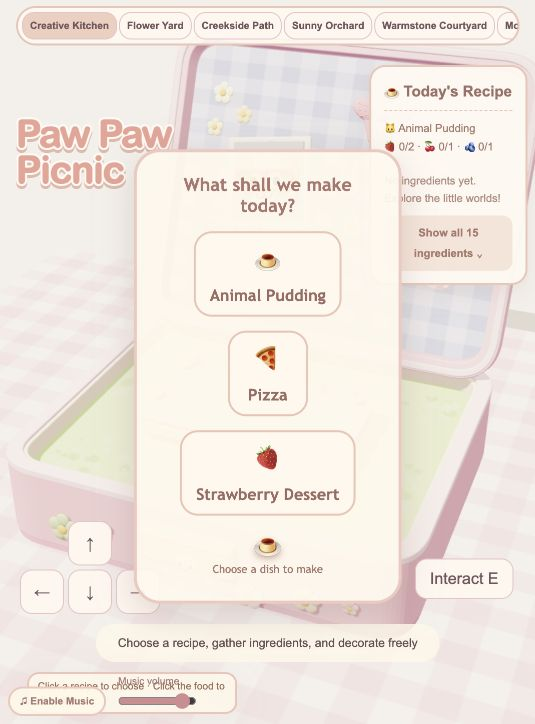
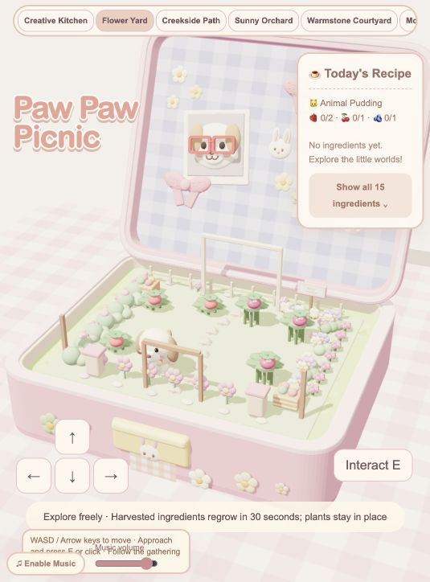
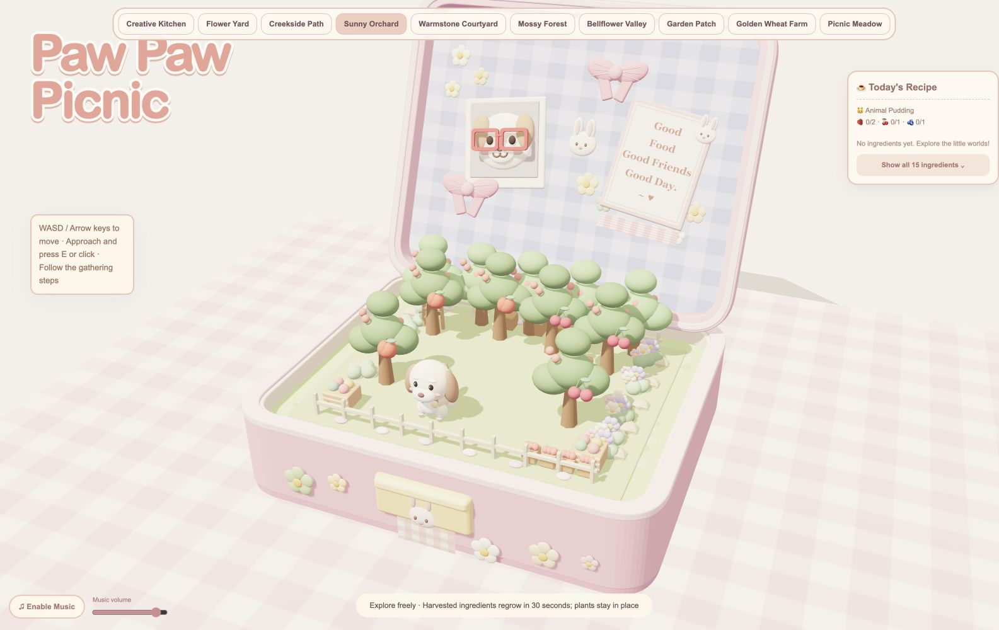

# Paw Paw Picnic
### A Little World in a Box

A relaxing 3D browser game about a puppy, miniature places, and preparing a picnic for friends.

**[Play on GitHub Pages](https://baqidiguadacangshu.github.io/PawPawPicnic/)** · [Development process and AI use](PROCESS.md)

Created for **SD5913 Assignment 3**.

## About the project

Paw Paw Picnic invites players to explore small environments inside an opening pink picnic box, collect ingredients, and make their own food. It is intended for casual players who enjoy cute miniature worlds and want a short, gentle break without competitive pressure.

My design idea is that games do not always need competition, time limits, or failure to be enjoyable. Players can choose a recipe, explore at their own pace, or simply enjoy the details. I want the experience itself to feel rewarding, rather than making task completion the only goal.

## Visual design

Soft pastel colours, low-poly models, rounded shapes, and gingham details give the world a toy-like appearance. Miniature models, childhood toy boxes, and pop-up storybooks inform the visual direction. The opening picnic box frames each environment as a small collectible world.

Locations have distinct plants, structures, ground colours, and decorative details. The current code provides eight gathering locations, plus Creative Kitchen and Picnic Meadow, including Flower Yard, Sunny Orchard, Mossy Forest, and Golden Wheat Farm.

## How to play

1. Start in **Creative Kitchen** and select Animal Pudding, Pizza, or Strawberry Dessert. The recipe panel shows the ingredients needed.
2. Choose a named location in the top navigation. Select an ingredient in the basket to see its location and gathering instructions.
3. Move the puppy close to a gathering spot. Press **E** or click the spot, repeating the displayed steps when needed. Ingredients use different actions, such as picking, uncovering, or harvesting.
4. Return to Creative Kitchen when you have enough ingredients. Choose a topping, then click the food to decorate it.
5. Select **Finish Cooking** to bring your creation to Picnic Meadow. Explore or start again whenever you like.

| Input | System response | Feedback to the player |
| --- | --- | --- |
| Select a recipe | Set ingredient requirements | Recipe name and collected/required counts |
| Select a location | Switch the miniature environment | Scene transition and active location name |
| Approach a gathering spot and press E or click | Perform the next harvesting step | Tool/ingredient animation and instruction text; inventory increases after the final step |
| Select a topping and click the food | Place a decoration | The topping appears on the food |
| Finish cooking | Move the finished dish to the picnic | Displayed dish and completion feedback |

This creates the core loop: **choose → explore → gather → check progress → decorate → share at the picnic**. Gathered produce regrows after 30 seconds; this is a replenishment delay, not a failure timer.

### Controls

- **WASD / arrow keys:** move the puppy.
- **E / click a nearby gathering spot:** interact.
- **Drag / scroll:** rotate the camera / zoom.
- **Location buttons:** travel between places.
- **Touch devices:** on-screen movement and interaction buttons are provided; device testing remains limited.
- **Music button / volume slider:** enable or mute music and adjust volume. Audio requires a user action.

## Screenshots

Actual screenshots captured from the [live game](https://baqidiguadacangshu.github.io/PawPawPicnic/) on 31 October 2026, at the browser's narrow viewport. These show the running interface without retouching.

### Choose a recipe



Choose Animal Pudding, Pizza, or Strawberry Dessert before gathering ingredients.

### Explore Flower Yard



The puppy explores a miniature garden inside the picnic box, with recipe progress visible.

### Visit Sunny Orchard



Named locations offer different scenery and ingredients. These captures document recipe selection and exploration; they do not demonstrate a completed cooking session.

## Run locally

Use Node.js **22.12 or later** and npm; the deployment workflow uses Node 22. The locked Vite version requires Node `^20.19.0 || >=22.12.0`.

```sh
git clone https://github.com/Baqidiguadacangshu/PawPawPicnic.git
cd PawPawPicnic
npm ci
npm run dev
```

Open the local URL printed by Vite, using the configured `/PawPawPicnic/` path if needed. Do not open `index.html` directly: the project imports Three.js through npm and needs Vite to resolve it.

```sh
npm run build
```

This creates `dist/`. The existing GitHub Actions workflow installs dependencies, builds the game, and deploys that folder to GitHub Pages when `main` is updated. `package.json` defines `dev` and `build`; it has no `preview` script. Its `test` script is a placeholder that exits with an error.

## Known limitations and troubleshooting

- A modern WebGL-capable browser is required. Mobile controls and responsive styles exist, but broad device compatibility and accessibility have not been established.
- Progress is held in memory; refreshing or restarting clears it. There is no persistent save system.
- Some static HTML, accessibility labels, and loading/error text remain in Chinese and retain older strawberry-task wording, despite the newer English game interface.
- If gathering does not start, move closer, wait for the current action to finish, and follow the next displayed step. Missing recipe ingredients produce a requirements message instead of starting cooking.
- If music cannot start, click the music button and check browser audio permissions. The game displays an unavailable-audio message if initialization fails.
- If loading fails locally, use `npm ci` and `npm run dev`, then check the browser console. The existing error message mentions Live Server/jsDelivr; that advice is outdated for this npm/Vite setup. The loader catches import errors, but there is no dedicated WebGL fallback screen.
- The build currently reports an ESM/CommonJS configuration warning and a JavaScript chunk over 500 kB. Build success does not establish smooth performance on every device.

## Development, testing, and AI assistance

I used **ChatGPT and OpenAI Codex** to help develop the project while making the design decisions and evaluating the results. Iterations, reflection, the existing user-testing account, and AI-use details are in [PROCESS.md](PROCESS.md).

On 31 October 2026, `npm ci` and `npm run build` passed. The deployed game bundle matched the local production build byte for byte. This verifies source/deployment consistency, not full gameplay or visual quality. The process document identifies the remaining test evidence to add. Actual development commits can be reviewed in the [Git history](https://github.com/Baqidiguadacangshu/PawPawPicnic/commits/main/).

## Credits

- **Project concept and design direction:** the Paw Paw Picnic creator, GitHub account [Baqidiguadacangshu](https://github.com/Baqidiguadacangshu).
- **3D rendering and camera controls:** [Three.js](https://threejs.org/) and its OrbitControls / RoundedBoxGeometry addons, MIT licensed.
- **Development and build tooling:** [Vite](https://vite.dev/), MIT licensed. Exact installed versions are recorded in `package-lock.json`.
- **Models, patterns, and scenery:** constructed procedurally in `game.js`; no external image, texture, or model files are tracked in the current repository.
- **Music and sound effects:** synthesized in the browser using Web Audio oscillators and note sequences in `game.js`; no external audio files are tracked. This documents implementation, not independent verification of musical originality.
- **Interface symbols:** Unicode emoji rendered by the device; fonts use the system font stack.
- **AI assistance:** ChatGPT and OpenAI Codex; see [PROCESS.md](PROCESS.md).

`package.json` declares ISC, but the repository currently contains no standalone LICENSE file. Add or clarify a project license before presenting reuse terms as complete.
